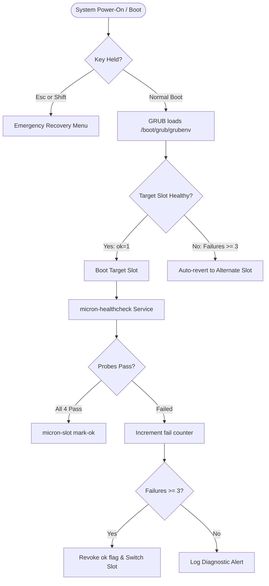

# Micron OS — A/B Dual-Boot, Recovery & Configuration Storage Architecture
## Complete Engineering Specification: Dual-Slot Booting, Filesystem Synchronization, 3-Tier Recovery & Single-File Configuration Storage

---

## Table of Contents
1. [Executive Overview & Design Philosophy](#1-executive-overview--design-philosophy)
2. [Storage Architecture & Partition Layout](#2-storage-architecture--partition-layout)
3. [How Slot A & Slot B Work](#3-how-slot-a--slot-b-work)
4. [Filesystem Synchronization Mechanics](#4-filesystem-synchronization-mechanics)
5. [The 3-Tier System Recovery Process](#5-the-3-tier-system-recovery-process)
6. [Configuration Storage: Single File Architecture](#6-configuration-storage-single-file-architecture)
7. [Comparison: Micron OS vs. pfSense vs. VyOS](#7-comparison-micron-os-vs-pfsense-vs-vyos)
8. [Operator Command Reference & Cheatsheet](#8-operator-command-reference--cheatsheet)

---

## 1. Executive Overview & Design Philosophy

Micron OS is engineered as a carrier-grade Linux firewall and network appliance. Unlike generic Linux distributions that rely on a single root partition, or traditional open-source firewalls that write monolithic text configuration files, Micron OS implements two core architectural pillars:

```
┌────────────────────────────────────────────────────────────────────────┐
│                        MICRON OS CORE PILLARS                          │
├───────────────────────────────────┬────────────────────────────────────┤
│ 1. Immutable A/B Dual-Slot Boot   │ 2. Single-File Relational Database │
├───────────────────────────────────┼────────────────────────────────────┤
│ • Two identical OS root slots     │ • Single database file (SQLite 3)  │
│ • Ping-pong atomic upgrades       │ • WAL write-ahead logging (ACID)   │
│ • Automatic fallback on failure   │ • Zero-byte corruption immunity    │
│ • Persistent state isolation      │ • Single-document portable (.mbk)  │
└───────────────────────────────────┴────────────────────────────────────┘
```

### The Problems This Architecture Solves
1. **The "Bricked Appliance" Problem:** If an OS kernel update or network stack upgrade fails on a single-root system, the appliance becomes inaccessible. With A/B dual slots, updates are written to the inactive slot. If it fails health probes, the bootloader automatically reverts to the Last Known Good Configuration (LKGC).
2. **The "0-Byte Corrupt Config" Problem:** Monolithic flat files (`config.xml` in pfSense or `config.boot` in VyOS) are vulnerable to power cuts during file rewriting, frequently resulting in a 0-byte truncated file and complete loss of settings. Micron OS uses SQLite with Write-Ahead Logging (WAL), guaranteeing atomic commits that survive sudden power disconnects.
3. **State Pollution:** User configurations, traffic logs, and certificates do not live inside the operating system partition. They reside on a dedicated persistent data partition, ensuring slot switches or OS re-installations never wipe user settings.

---

## 2. Storage Architecture & Partition Layout

When the bare-metal installer (`installer/install.sh`) provisions an appliance storage drive (NVMe, SATA SSD, eMMC, or Virtual Disk), it establishes a standardized **GPT 6-Partition Layout**:

```
+-------------------------------------------------------------------------------------------------------+
|                                    PHYSICAL APPLIANCE STORAGE DRIVE                                    |
+------------+------------+------------+--------------------+--------------------+----------------------+
|     p1     |     p2     |     p3     |         p4         |         p5         |          p6          |
|    ESP     | BIOS-BOOT  |    SWAP    |    MICRON_ROOT_A   |    MICRON_ROOT_B   |     MICRON_DATA      |
|  (FAT32)   |   (Raw)    |   (Swap)   |       (ext4)       |       (ext4)       |        (ext4)        |
|   512 MB   |    1 MB    |    4 GB    |       10 GB        |       10 GB        |    Remaining (20GB+) |
+------------+------------+------------+--------------------+--------------------+----------------------+
| /boot/efi  | GRUB Stage | Swap space | Active Root Slot A | Backup Root Slot B | Mount: /var/lib/micron
| UEFI Boot  | Legacy MBR | System RAM | Primary Appliance  | Standby Fallback   | Config, DB, Logs, VPN
+------------+------------+------------+--------------------+--------------------+----------------------+
```

### Partition Specification Table

| # | Device Node | Label | Filesystem | Mount Point | Description |
| :---: | :--- | :--- | :---: | :--- | :--- |
| **1** | `/dev/sda1` | `ESP` | FAT32 | `/boot/efi` | EFI System Partition containing GRUB2 x86_64 binaries (`/EFI/BOOT/` and `/EFI/micron-os/`). |
| **2** | `/dev/sda2` | `BIOS-BOOT` | Raw | *(None)* | GRUB core image embed area for legacy BIOS/MBR compatibility on hybrid systems. |
| **3** | `/dev/sda3` | `MICRON_SWAP`| Swap | `[swap]` | Virtual memory paging area. |
| **4** | `/dev/sda4` | `MICRON_ROOT_A`| ext4 | `/` *(Active A)* | **Operating System Slot A:** Linux kernel, PHP 8.4 runtime, Web GUI, and core system daemons. |
| **5** | `/dev/sda5` | `MICRON_ROOT_B`| ext4 | `/` *(Active B)* | **Operating System Slot B:** Complete second system root for atomic upgrades and failover. |
| **6** | `/dev/sda6` | `MICRON_DATA` | ext4 | `/var/lib/micron` | **Persistent Storage Partition:** Carries configuration database, TLS certs, logs, and user data. |

---

## 3. How Slot A & Slot B Work

### 3.1 Active vs. Standby Roles
Only **one slot** functions as the active system root (`/`) at any given moment:

- **When Booted into Slot A:**
  - Partition `/dev/sda4` is mounted as `/` (`rw,noatime,errors=remount-ro`).
  - Partition `/dev/sda5` is dormant, configured in `/etc/fstab` with `noauto,nofail` at `/mnt/micron-slot-b`.
- **When Booted into Slot B:**
  - Partition `/dev/sda5` is mounted as `/`.
  - Partition `/dev/sda4` is dormant, configured at `/mnt/micron-slot-a`.

### 3.2 Dynamic Slot Identification
The active slot is never guessed by partition numbers (which can change between NVMe, SATA, and virtual disks). Instead, the system determines the running slot strictly by **filesystem volume label**:

```bash
ROOT_DEV=$(findmnt -n -o SOURCE / 2>/dev/null || true)
ROOT_LABEL=$(blkid -s LABEL -o value "$ROOT_DEV" 2>/dev/null || true)

case "$ROOT_LABEL" in
    MICRON_ROOT_A) ACTIVE_SLOT="A" ;;
    MICRON_ROOT_B) ACTIVE_SLOT="B" ;;
esac
```

This slot identity is continuously surfaced in the login banner (`micron-banner`), the console manager (`micron-menu`), and the Web UI status bar.

---

## 4. Filesystem Synchronization Mechanics

A common question is: *“How do Slot A and Slot B synchronize files between each other?”*

### 4.1 Deliberate Decoupling (No Real-Time Sync)
Slot A and Slot B are **intentionally not synchronized in real time**. 
- If files were mirrored continuously, any accidental binary truncation, malicious file deletion, or failed update on Slot A would instantly replicate to Slot B, defeating the entire purpose of redundancy.
- Instead, synchronization occurs **strictly during controlled events**: Initial Installation, Firmware Updates, and Disaster Recovery.

```
+-------------------------------------------------------------------------+
|                  SYNCHRONIZATION & SEPARATION MODEL                     |
+-------------------------------------------------------------------------+
|                                                                         |
|   +-----------------------+                   +---------------------+   |
|   |      SLOT A (OS)      |                   |     SLOT B (OS)     |   |
|   |  Kernel 6.x, Apache2  |                   | Kernel 6.x, Apache2 |   |
|   |  PHP 8.4, Web GUI     |                   | PHP 8.4, Web GUI    |   |
|   +-----------+-----------+                   +----------+----------+   |
|               |                                          |              |
|               | Controlled Clone / Upgrade (rsync/image) |              |
|               |<========================================>|              |
|               |                                          |              |
|               \─────────────────────┬────────────────────/              |
|                                     │                                   |
|                                     ▼                                   |
|                       +---------------------------+                     |
|                       |   MICRON_DATA (/dev/sda6) |                     |
|                       |   Mounted: /var/lib/micron|                     |
|                       |---------------------------|                     |
|                       | • micron_config.db (Conf) |                     |
|                       | • Backups & Certificates  |                     |
|                       | • WireGuard / IPsec keys  |                     |
|                       +---------------------------+                     |
+-------------------------------------------------------------------------+
```

### 4.2 Initial Installation Provisioning
During appliance deployment, `installer/install.sh` extracts the golden operating system image (`filesystem.squashfs`) to **both** Slot A (`/dev/sda4`) and Slot B (`/dev/sda5`). Both slots leave the factory in a verified, bootable state.

### 4.3 Atomic Firmware Upgrades (The Ping-Pong Lifecycle)
1. System is running on **Slot A**.
2. Administrator triggers an update via Web UI or CLI (`microctl update`).
3. The updater leaves Slot A mounted as `/` and mounts **Slot B** at `/mnt/target_upgrade`.
4. The new kernel and binaries are extracted directly into Slot B.
5. The GRUB boot environment block is set to boot Slot B next:
   ```bash
   micron-slot activate b
   ```
6. The appliance reboots. If Slot B passes its health check, it becomes the new permanent active slot. Slot A remains as the untouched fallback.

### 4.4 Disaster Recovery & Slot Healing (Clone on Demand)
If Slot A suffers filesystem damage or bad blocks, the operator launches the **Slot Rescue Tool** (`micron-slot-rescue`). Selecting Option 3 or 4 clones the healthy slot using atomic `rsync`:

```bash
rsync -aAX --delete \
    --exclude={"/etc/fstab","/dev/*","/proc/*","/sys/*","/tmp/*","/run/*","/mnt/*","/media/*","/lost+found"} \
    "${RESCUE_MNT}/slot_b/" "${RESCUE_MNT}/slot_a/"
```

Immediately following the transfer, the rescue tool generates a clean `/etc/fstab` populated with Slot A's exact partition UUIDs:

```ini
# Micron OS Filesystem Table (Slot A)
UUID=e12a4b... /               ext4 defaults,noatime,errors=remount-ro 0 1
UUID=a49f1c... /boot/efi       vfat umask=0077                         0 1
UUID=9b8210... /var/lib/micron ext4 defaults,noatime,barrier=1,commit=5 0 2
UUID=f7103d... /mnt/micron-slot-b ext4 noauto,nofail                   0 0
```

---

## 5. The 3-Tier System Recovery Process

Micron OS implements an autonomous three-tier recovery hierarchy that requires zero human intervention for transient boot issues while offering powerful tools for field engineers.



### Tier 1: Autonomous GRUB Watchdog (`09_micron_slots` & `micron-healthcheck`)
1. **GRUB Environment Block (`/boot/grub/grubenv`):**
   A fixed 1024-byte block storing active variables:
   - `micron_active_slot=a` (Active boot slot)
   - `micron_a_ok=1` (1 = Verified healthy, 0 = Unverified / Degraded)
   - `micron_b_ok=1`
   - `micron_a_fail=0` (Consecutive failure tally)
   - `micron_b_fail=0`
2. **Boot Execution:**
   GRUB evaluates these flags. If the active slot's failure count reaches 3, GRUB automatically boots the alternate slot.
3. **Appliance Health Verification:**
   On startup, `micron-healthcheck.service` executes four core probes:
   - **Management:** Verifies Apache2 and PHP-FPM are alive.
   - **IPC:** Confirms the privileged `micrond` root daemon socket is responsive.
   - **Data Plane:** Ensures `nftables` packet filtering ruleset is loaded.
   - **Persistence:** Verifies the SQLite database `/var/lib/micron/micron_config.db` is writable.
4. If all probes pass, it runs `micron-slot mark-ok`.

### Tier 2: Pre-Boot Keyboard Intercept
If a hardware change or bad configuration prevents normal boot, an operator at the physical console (or virtual KVM) can press or hold **`Esc`** or **`Shift`** at power-on. GRUB intercepts this signal and defaults directly to the **Micron OS Recovery** menu without attempting the standard boot.

### Tier 3: Interactive Rescue Wizard (`micron-slot-rescue`)
Accessible via ISO live media, root shell, or **Option 17** in `micron-menu`:

```
┌──────────────────────────────────────────────────────────────────────┐
│  Micron OS Appliance Emergency Recovery & Slot Rescue                │
├──────────────────────────────────────────────────────────────────────┤
│ Detected Storage: /dev/sda                                           │
│   Slot A : /dev/sda4 (Healthy, Failures: 0)                          │
│   Slot B : /dev/sda5 (Healthy, Failures: 0)                          │
│   Active in GRUB: Slot A                                             │
├──────────────────────────────────────────────────────────────────────┤
│ Available Recovery Operations:                                       │
│   1) Make Slot B the PERMANENT Boot Target                           │
│   2) Make Slot A the PERMANENT Boot Target                           │
│   3) Clone & Repair Slot A from Slot B (Heal broken Slot A)         │
│   4) Clone & Repair Slot B from Slot A (Heal broken Slot B)         │
│   5) Run Filesystem Integrity Check (e2fsck) on Slot A & Slot B      │
│   6) Drop into Chroot Maintenance Shell on Slot A                    │
│   7) Drop into Chroot Maintenance Shell on Slot B                    │
│   8) Reboot Appliance                                                │
│   0) Exit to Shell                                                   │
└──────────────────────────────────────────────────────────────────────┘
```

---

## 6. Configuration Storage: Single File Architecture

### 6.1 The Runtime Single File: `micron_config.db`
Unlike platforms that scatter configuration across `/etc/network/interfaces`, `/etc/nftables.conf`, `/etc/dhcp/`, and `/etc/wireguard/`, Micron OS treats configuration as a **single relational database**:

```text
/usr/local/micron/writable/micron_config.db
(Physically persisted at /var/lib/micron/micron_config.db on Partition 6)
```

#### Database Schema Overview
The single SQLite file consolidates every appliance subsystem into relational tables:

```
                          micron_config.db
  ┌─────────────────────────────────────────────────────────────┐
  │  interfaces           -> physical ports, IP, VLANs, MTU     │
  │  firewall_rules       -> sequence, protocol, source, dest   │
  │  nat_dnat / snat      -> port forwards, outbound VIPs       │
  │  ipsec_tunnels        -> Phase 1/2 proposals, PSKs, routes  │
  │  wireguard_tunnels    -> private keys, listen ports, peers  │
  │  openvpn_servers      -> subnets, cipher suites, auth modes │
  │  webfilter_settings   -> Squid proxy, transparent ports     │
  │  ha_settings          -> CARP / VRRP, sync peer, failover   │
  │  roles & permissions  -> 109 RBAC granular access keys      │
  │  users & user_roles   -> local accounts, Argon2id passwords │
  │  system_settings      -> hostname, timezone, DNS, banners   │
  └─────────────────────────────────────────────────────────────┘
```

#### Crash-Invariance & WAL Journaling
To ensure safety on bare-metal hardware prone to power drops, the database is configured with:
```sql
PRAGMA journal_mode = WAL;
PRAGMA synchronous = FULL;
```
- Modifications append to `micron_config.db-wal` before committing to master pages.
- Hardware write barriers (`fsync`) guarantee that even if power is severed mid-transaction, SQLite performs automatic roll-forward or rollback upon restart with **zero database corruption**.

### 6.2 The Compilation Engine: From Database to Linux Kernels
When an administrator saves a firewall rule or IP address, the configuration does not stay in the database. A compiler chain immediately translates database records into deterministic Linux configurations:

```
[Web GUI / CLI] ──> [micron_config.db] ──> [micrond Daemon]
                                                   │
    ┌────────────────┬────────────────┬────────────┴───┬────────────────┐
    ▼                ▼                ▼                ▼                ▼
/etc/nftables.conf  /etc/swanctl/  /etc/wireguard/  /etc/kea/       /etc/unbound/
 (nftables ruleset) (IPsec swanctl) (wg0.conf)      (DHCP4 server)  (DNS resolver)
```

### 6.3 The Portable Single File: `.mbk` / `.mbk.enc`
When administrators export or backup the configuration, `App\Libraries\BackupEngine` serializes the entire database into a **single, portable document**:

- **Plain JSON (`.mbk`):** A human-readable JSON file containing every table, row, and hardware interface mapping.
- **Encrypted JSON (`.mbk.enc`):** An encrypted archive wrapped in the `MICRON_ENC_V1` envelope using **AES-256-GCM** with **PBKDF2-SHA256** (100,000 rounds) key derivation.

---

## 7. Comparison: Micron OS vs. pfSense vs. VyOS

| Architectural Vector | pfSense / OPNsense | VyOS | **Micron OS** |
| :--- | :--- | :--- | :--- |
| **Configuration Format** | Monolithic XML (`config.xml`) | Hierarchical text (`config.boot`) | **Single Relational Database (`micron_config.db`)** |
| **Backup File Format** | XML export | Plaintext script | **JSON document (`.mbk`) or AES-256-GCM (`.mbk.enc`)** |
| **Dual Boot Strategy** | None (Single partition) *(ZFS boot environments optional)* | Image-based GRUB selection | **A/B Dual Partitioning (Dedicated Slot A & Slot B)** |
| **Power-Loss Safety** | High risk of truncated 0-byte XML | Moderate (session lockfiles) | **High (SQLite WAL + fsync write barriers)** |
| **State Separation** | Config in `/cf/conf/` on OS root | Config in `/config/` on OS root | **Strict separation (`MICRON_DATA` partition `/dev/sda6`)** |
| **Hardware NIC Remap** | Interactive console prompt on boot | Manual text editing of config | **Automatic hardware difference inspector & remap engine** |
| **Emergency Rescue** | Manual single-user shell | Recovery boot into older image | **Interactive TUI wizard (`micron-slot-rescue`)** |

---

## 8. Operator Command Reference & Cheatsheet

### 8.1 Boot Slot Management (`micron-slot`)
```bash
# Display all slot environment variables
micron-slot show

# Check which slot is currently active (a or b)
micron-slot active

# Set Slot B to boot next
micron-slot activate b

# Manually verify and mark Slot A healthy
micron-slot mark-ok a

# View consecutive failure counts
micron-slot fail-count a
```

### 8.2 Emergency Slot Rescue (`micron-slot-rescue`)
```bash
# Launch the interactive recovery wizard
micron-slot-rescue

# Display slot partition health and failure counters
micron-slot-rescue status

# Permanently switch boot target from CLI
micron-slot-rescue a
micron-slot-rescue b
```

### 8.3 Single-File Backup & Restore (`microctl`)
```bash
# Create an encrypted configuration backup (.mbk.enc)
microctl backup create /root/firewall_backup.mbk.enc --password "SecurePassphrase123"

# Create a plain JSON backup (.mbk)
microctl backup create /root/firewall_backup.mbk

# Restore an existing backup archive
microctl backup restore /root/firewall_backup.mbk

# Inspect hardware NIC differences before restoring
microctl backup inspect /root/firewall_backup.mbk
```

### 8.4 Checking SQLite Configuration Database
```bash
# Check database integrity
sqlite3 /usr/local/micron/writable/micron_config.db "PRAGMA quick_check;"

# Inspect configured interfaces
sqlite3 -header -column /usr/local/micron/writable/micron_config.db \
  "SELECT id, physical_device, ip_assignment_type, ipv4_address FROM interfaces;"

# View active firewall rules
sqlite3 -header -column /usr/local/micron/writable/micron_config.db \
  "SELECT sequence, protocol, source_value, dest_value, action FROM firewall_rules WHERE enabled=1 ORDER BY sequence ASC;"
```
